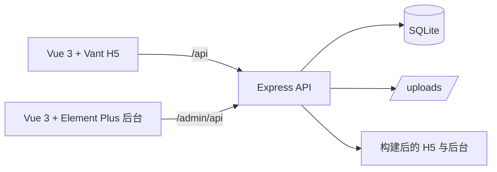

# 北山商城

北山商城是一套围绕**场次抢购、商品货权、转拍寄售**构建的全栈商城项目，包含 H5 商城、运营管理后台和 Node.js API 服务。项目使用 SQLite 保存业务数据，支持本地开发和 Docker 一体化部署。

## 功能概览

- **场次抢购**：按场次配置商品和开放时间；前台展示商品库存、锁单状态和售罄状态。
- **订单审核**：会员提交订单后由后台审核确认，支持订单、付款状态和内部发货状态管理。
- **独立货权**：每件成交商品归属买家。按件库存成交时为买家生成独立商品货权；单件商品成交时更新该商品的持有人。
- **我的店铺与转拍**：买家可查看自己持有的商品并按规则重新上架；商品与场次通过关联关系管理。
- **价格与费用配置**：转拍涨价率、服务费、上架费等业务参数由后台配置。
- **后台管理与权限**：管理商品、场次、会员、订单、财务、系统配置和媒体资源；菜单和操作按管理员角色授权。
- **管理员审计**：记录管理后台操作；超级管理员查看全部记录，受限管理员查看自己的操作记录。
- **营销与会员功能**：邀请码、邀请关系、佣金/资金记录、积分商城、站内消息及相关会员页面。
- **H5 与 PWA**：移动端优先的商城界面，包含首页、分类、抢购、搜索、商品详情、订单和我的店铺等页面。

## 核心交易与货权规则

1. 商品加入一个或多个抢购场次后，会员可以在开放时间内提交或锁定订单。
2. **锁单不等于商品下架，也不等于货权转移。** 批量库存的可售数量会按订单规则扣减；只要仍有可售库存，商品仍可继续销售。
3. 订单经后台确认成交后，货权归买家：
   - 单件商品：将商品持有人更新为买家。
   - 按件库存商品：为买家生成对应的独立商品货权记录；平台或卖家的库存池继续按剩余库存销售，售罄后才显示为售罄。
4. 买家可在「我的店铺」查看已获得的商品，并按转拍规则再次上架。转拍商品按配置计算价格，并关联到后续销售场次；上架费在下单时收取，转拍时不重复收取。
5. 后台可处理订单货权转让；转让及其他管理操作会写入管理员审计记录。

> 订单确认、货权归属和可售库存是不同状态。批量商品的库存池状态不能代替买家名下的独立货权记录。

## 系统结构



| 模块 | 技术 | 开发地址 |
|---|---|---|
| API 服务 | Node.js 22、Express 5、内置 `node:sqlite` | `http://127.0.0.1:3300` |
| 管理后台 | Vue 3、Element Plus、Vite | `http://127.0.0.1:5274` |
| H5 商城 | Vue 3、Vant 4、Vite、PWA | `http://127.0.0.1:5273` |
| 数据库 | SQLite，启用 WAL 与外键约束 | `server/data/mall.db` |
| 部署 | Docker Compose、Node.js 22 | 容器内默认端口 `3300` |

## 环境要求

- Node.js **22.x**（项目使用内置 `node:sqlite`）
- npm
- Docker 与 Docker Compose（仅 Docker 部署需要）

建议在项目根目录执行命令。Windows PowerShell、macOS 和 Linux 均可使用 npm 命令。

## 本地开发

### 1. 安装依赖

仓库分别维护服务端、后台和 H5 的依赖：

```bash
npm install --prefix server
npm install --prefix admin
npm install --prefix h5
```

### 2. 初始化演示数据

```bash
npm run seed
```

初始化脚本只在数据库尚无后台账号时灌入演示数据；已初始化的数据库会跳过，不会覆盖现有数据。默认数据库文件为 `server/data/mall.db`。

### 3. 启动开发服务

```bash
npm run dev
```

该命令同时启动 API、后台 Vite 和 H5 Vite，按 `Ctrl+C` 结束。访问：

| 页面 | 地址 |
|---|---|
| H5 商城 | [http://127.0.0.1:5273](http://127.0.0.1:5273) |
| 管理后台 | [http://127.0.0.1:5274](http://127.0.0.1:5274) |
| API 健康检查 | [http://127.0.0.1:3300/api/health](http://127.0.0.1:3300/api/health) |

Vite 会将 API 和上传请求代理到本地后端。若端口被占用，请先停止占用进程或修改对应 Vite 配置。

### 演示账号

仅用于本地演示数据：

| 入口 | 账号 | 密码 |
|---|---|---|
| 管理后台 | `admin1` | `123456` |
| H5 会员 | `13822367845` | `13822367845` |

请勿在公开或生产环境使用演示密码。后台内置账号只在首次创建时使用环境变量密码；账号已存在时普通重启不会覆盖已有密码。

## 一体化构建与运行

前端构建产物会汇总到 `public/admin` 与 `public/h5`，该目录为生成内容，不纳入 Git：

```bash
npm run build
npm start
```

启动后通过同一个 API 进程访问：

| 服务 | 路径 |
|---|---|
| H5 商城 | `/` |
| 管理后台 | `/admin/` |
| H5 API | `/api/` |
| 后台 API | `/admin/api/` |
| 上传文件 | `/uploads/` |
| 健康检查 | `/api/health` |

也可以只启动 API；如果 `public/admin` 和 `public/h5` 尚未构建，服务端仍可提供 API。

## Docker 部署

### 首次部署

复制配置模板并修改生产密钥：

```bash
cp .env.example .env
```

至少设置强随机 `JWT_SECRET` 和强管理员密码。之后构建并启动：

```bash
docker compose up -d --build
npm run docker:url
docker compose logs -f
```

Compose 默认由 Docker 为宿主机分配空闲端口。查看实际端口也可运行：

```bash
docker compose port mall 3300
```

如果需要固定宿主机端口，在 `.env` 设置 `APP_PORT=3300`（或其他可用端口）。

### 数据持久化与升级

- 容器内数据库和上传文件位于 `/app/data`，映射到项目目录的 `./data`。
- 首次启动且数据库不存在时，镜像入口会初始化数据库并写入演示数据；上线前请检查并替换演示内容。
- 更新代码后使用 `docker compose up -d --build` 重建镜像和容器。
- 修改 `.env` 后也要执行 `docker compose up -d` 让新环境变量生效；单独执行 `docker compose restart` 不会重新读取 Compose 配置。
- 备份时同时保存数据库和上传目录。稳妥做法是先停止服务，再完整备份 `./data`；恢复时将备份数据放回后再启动服务。
- `docker compose down` 停止并移除容器，不会删除项目目录中的 `./data`。

启用域名和 HTTPS 后可使用 PWA 安装能力。反向代理应将请求转发到容器服务端口，并保留 `/api`、`/admin/api` 和 `/uploads` 路径。

## 配置说明

Docker Compose 会自动读取项目根目录的 `.env`。非 Docker 启动时，请在操作系统或启动命令中设置环境变量；项目不依赖 dotenv 自动加载本地 `.env`。

| 变量 | 默认值/行为 | 说明 |
|---|---|---|
| `HOST` | `127.0.0.1`；容器内为 `0.0.0.0` | API 监听地址 |
| `PORT` | `3300` | API 监听端口 |
| `MALL_DB` | `server/data/mall.db` | SQLite 数据库路径；显式相对路径按 `server/data` 解析 |
| `UPLOAD_DIR` | `server/data/uploads` | 上传文件目录 |
| `PUBLIC_DIR` | 项目根目录的 `public` | 一体化构建产物目录 |
| `PUBLIC_BASE_URL` | 空 | 图片返回相对路径；使用 CDN 或代理域名时可设置站点基址 |
| `JWT_SECRET` | 未设置时生成并保存在本地数据目录 | JWT 签名密钥；生产环境必须显式设置强随机值 |
| `ADMIN_USER` | `admin1` | 首次创建的内置超级管理员账号 |
| `ADMIN_PASSWORD` | `123456` | 首次创建内置管理员时使用；生产环境必须设置强密码 |
| `ADMIN_PASSWORD_RESET` | `0` | 设为 `1` 后启动时将内置账号密码重置为 `ADMIN_PASSWORD`，重置后应立即改回 `0` |
| `TZ` | Docker 默认 `Asia/Shanghai` | 容器系统时区 |
| `SQL_GUARD` | 开启 | SQL 参数数量校验；仅在明确需要时设为 `0` 关闭 |

管理员首次启动后请登录后台修改密码，并妥善保管 `JWT_SECRET`。不要把 `.env`、数据库、上传目录或 `server/data/.jwt-secret` 提交到代码仓库。

## 数据与演示环境维护

### 重新灌入演示数据

`npm run seed` 在检测到已有后台账号时会退出，不会清空或覆盖现有数据库。需要重新开始演示流程时，可使用：

```bash
node scripts/reset-demo.mjs
```

脚本默认只展示将执行的动作；确认目标为演示数据库后，再执行：

```bash
node scripts/reset-demo.mjs --yes
```

该脚本会备份数据库后重建演示基线，并清除会员、订单及相关交易数据。**不要对生产数据库运行此脚本。** 备份文件默认写入 `server/data/backup/`。

### 数据库说明

- SQLite 数据文件默认在 `server/data/mall.db`；Docker 部署对应 `./data/mall.db`。
- 服务启动时会执行必要的兼容性结构检查；正式升级前仍建议先做完整备份。
- SQLite 与上传文件都属于运行数据，不在代码仓库中版本管理。

## 测试、构建与版本

```bash
npm test                 # 服务端核心业务测试
npm run build            # 构建后台和 H5 到 public/
npm run version:show     # 查看 H5 版本号
npm run version:patch    # 版本号递增 patch
npm run version:bump     # 版本号递增 minor
```

专项验证脚本位于 `scripts/probe/`，例如货权及多轮转拍验证。请阅读脚本说明并确认测试数据库与端口后再运行。

## 目录结构

```text
.
├── admin/                 # Vue 3 + Element Plus 管理后台
├── h5/                    # Vue 3 + Vant 商城与 PWA
├── server/
│   ├── src/
│   │   ├── routes/         # H5 API 与后台 API
│   │   ├── lib/            # 订单、库存、货权、场次、审计等业务逻辑
│   │   ├── schema.sql      # SQLite 表结构
│   │   └── seed.js         # 演示数据初始化
│   └── test/               # 服务端核心测试
├── scripts/                # 构建、开发、版本和演示数据脚本
├── docs/                   # 业务、后台和技术说明
├── Dockerfile
├── docker-compose.yml
└── README.md
```

## 延伸文档

- [后台操作手册](docs/admin-manual.md)：后台功能、菜单与常见操作。
- [目标系统规格说明](docs/target-system-spec.md)：系统行为与业务规则整理。
- [转拍逻辑梳理](docs/转拍逻辑梳理.md)：转拍、货权和订单流转说明。
- [抢购专场配置复盘](docs/抢购专场配置复盘.md)：场次配置与商品关联。
- [API 覆盖说明](docs/api-coverage.md)：接口与功能覆盖情况。
- [订单拆分报告](docs/split-orders-report.md)：按件库存及订单货权相关记录。
- [审计报告](docs/full-audit-2026-10-30.md)：特定日期的代码审查快照，仅供追溯参考。

## 当前集成边界

当前仓库实现订单提交及后台审核/确认流程。部署前请按实际业务接入并验证支付、短信、物流等第三方服务；不要将后台人工确认流程视为已接通微信支付或支付宝。

## 许可证

仓库当前未附带开源许可证。使用、修改或再分发前，请先确认项目权利人与适用授权。
